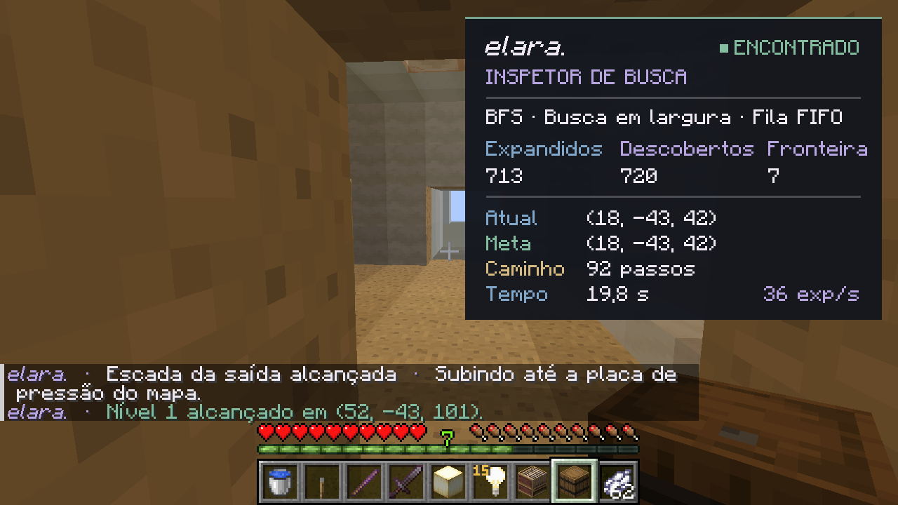

# Elara

*Todo caminho começa com uma escolha.*

Elara é um mod de Minecraft que mostra como BFS e DFS encontram caminhos. Marque o início e a meta, avance a busca passo a passo e veja os corredores virarem um grafo.

  
  

## Comece por aqui

Baixe o [JAR da versão mais recente](https://github.com/kyl8/elara/releases/latest) e coloque na pasta `mods` de uma instância **Minecraft 1.20.1** com **Java 17**, **Fabric Loader** e [Fabric API](https://modrinth.com/mod/fabric-api/versions?g=1.20.1).

Dentro do mundo, use `/elara help` para ver os comandos ou **F6** para abrir o inspetor. No [mapa Backrooms de Spinniest](https://www.planetminecraft.com/project/spinniest-s-vanilla-backrooms-map-unfinished-1-20-1/), `/elara exit bfs` busca a saída do Nível 0 e faz o personagem seguir o caminho.

Para compilar e rodar os testes no Windows, use `.\gradlew.bat build`.

O código é [MIT](LICENSE).
