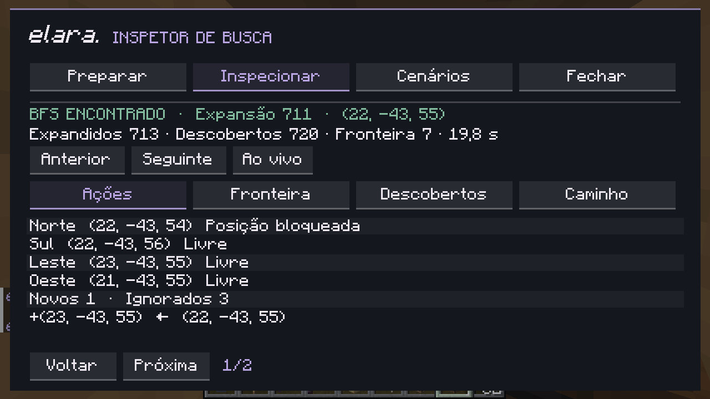

<h1>Elara</h1>

Watch BFS and DFS find their way through Minecraft.

<strong><a href="https://github.com/kyl8/elara/releases/latest">Download Elara</a></strong>

Minecraft 1.20.1 with Java 17, Fabric Loader 0.16.14 or newer, and <a href="https://modrinth.com/mod/fabric-api/versions?g=1.20.1">Fabric API for 1.20.1</a>. Keep one Elara JAR in <code>mods</code>.

<code>/elara finish</code> marks the destination. <code>/elara start</code> finds the route. 
In single-player, Elara walks from your current position and times the trip.

For larger mazes, use <code>/elara limits 128 32768</code>, mark both endpoints, then run <code>/elara scan</code>. 
Automatic scans grow within loaded chunks as needed. Compare <code>/elara run bfs</code> and <code>/elara run dfs</code> on the same graph.

Press <strong>F6</strong> for the route panel or run <code>/elara help</code> for commands.

For slower PCs, <code>/elara overlay</code> switches off the 3D markers while keeping search and the HUD available. <a href="https://prismlauncher.org/wiki/getting-started/installing-java/">Java setup for Prism Launcher</a>.

  
See the route panel

  

<a href="https://www.planetminecraft.com/project/spinniest-s-vanilla-backrooms-map-unfinished-1-20-1/">Backrooms map by Spinniest</a> 
<a href="CHANGELOG.md">Changelog</a> · <a href="LICENSE">MIT License</a>

